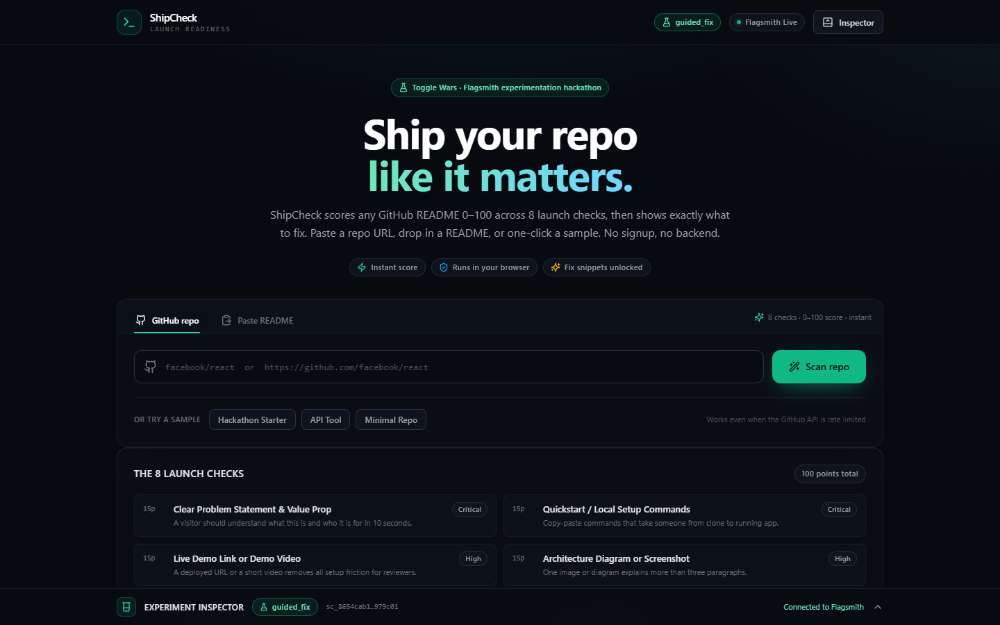
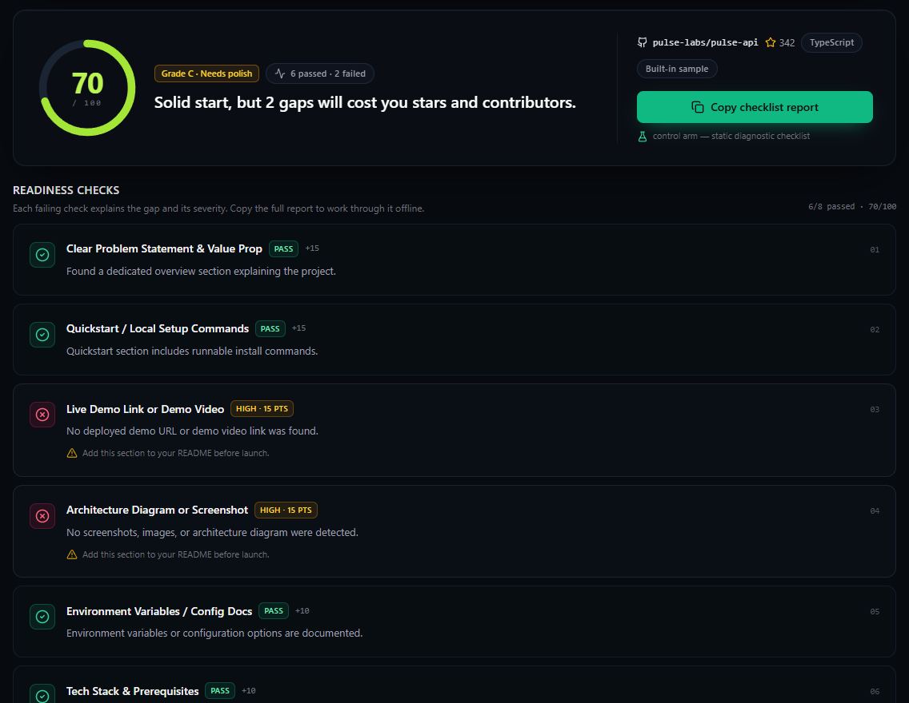
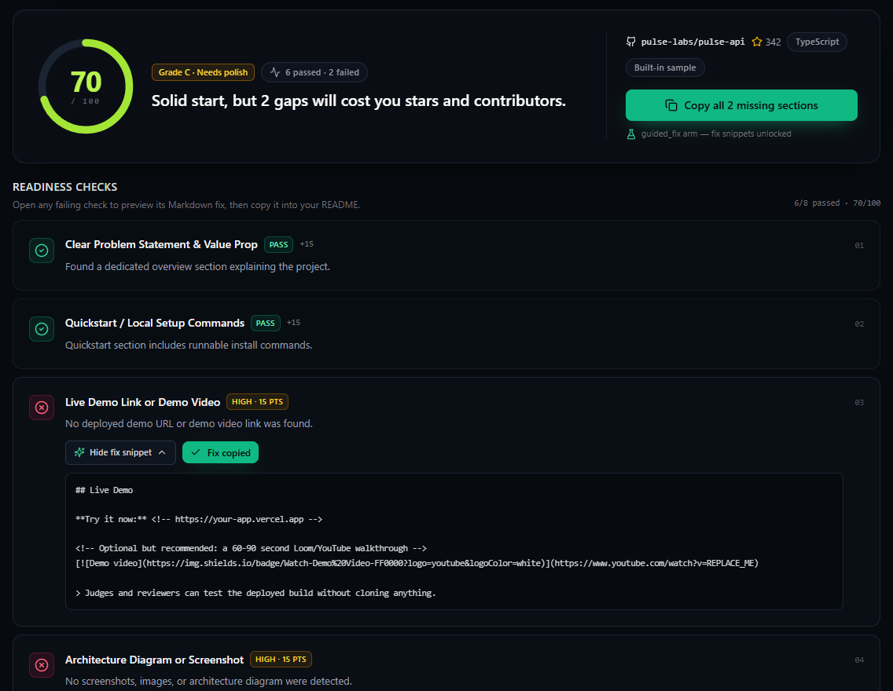
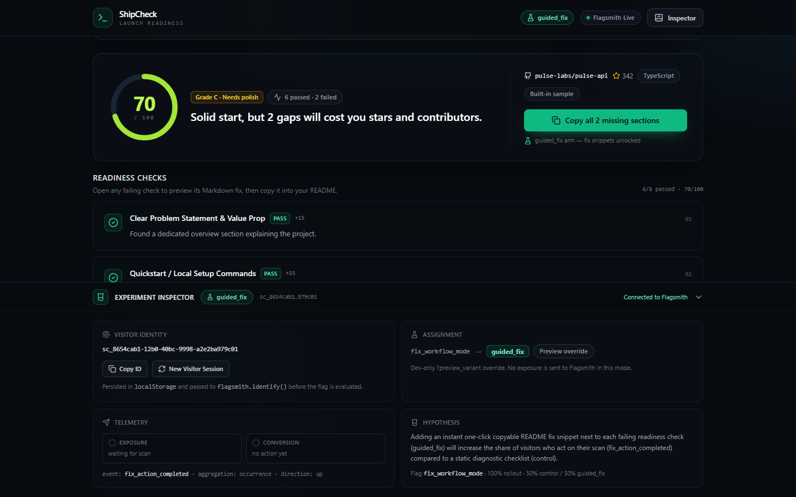

# ShipCheck

**Instant GitHub repo & README readiness checker for hackathon and open-source launches.**

ShipCheck scores any public GitHub repository's README from **0–100** across **8 concrete launch checks**, then tells the author exactly what is missing. It runs entirely in the browser, needs no backend, and ships with a live **Flagsmith multivariate experiment** that tests whether copyable fix snippets increase the share of visitors who act on a scan.




---

## Why ShipCheck exists

Hackathon judges, maintainers, and recruiters decide whether to try a project in about ten seconds. Most repositories lose them before the first `npm install` because the README never answers three questions:

1. **What is this and who is it for?**
2. **How do I run it?**
3. **Why should I trust that it works?**

ShipCheck turns that vague feedback into a deterministic score, a severity-ranked checklist, and — for the treatment arm — a ready-to-paste Markdown fix for every failing check. No signup, no database, no server: paste a repo URL, a README, or click one of three built-in samples.

---

## The experiment

| | |
| --- | --- |
| **Track** | Track 01 — *Test Something Real* |
| **Hypothesis** | Adding an instant one-click copyable README fix snippet next to each failing readiness check (`guided_fix`) will increase the share of visitors who act on their scan (`fix_action_completed`) compared to a static diagnostic checklist (`control`). |
| **Multivariate flag** | `fix_workflow_mode` |
| **Control** | `control` — diagnostic checklist, severity badges, one “Copy checklist report” export |
| **Variant** | `guided_fix` — every failing check expands into a syntax-highlighted Markdown snippet with “Copy fix snippet” and “Copy all missing sections” |
| **Primary metric** | `fix_action_completed` — `aggregation: occurrence`, `direction: up`, event name case-sensitive |
| **Rollout** | 100% of traffic, 50 / 50 split |
| **Exposure** | Recorded only when a scan result is rendered, via `getExperimentFlag("fix_workflow_mode")` after `identify(visitor_id)` |
| **Conversion** | Copying a fix snippet, copying all fixes, or exporting the checklist report |

Both arms share the same analyzer, the same score, and the same checks. The **only** difference is how the fix is delivered: static guidance (`control`) versus an instantly copyable artifact (`guided_fix`). That keeps the experiment honest — the treatment changes the *effort to act*, not the diagnosis.

### Identity continuity

One anonymous visitor id is generated per browser and stored in `localStorage`:

```ts
// src/lib/flagsmith.ts
const visitorId = `sc_${crypto.randomUUID()}`   // persisted as shipcheck_visitor_id
await flagsmith.identify(visitorId)             // BEFORE flag evaluation
const flag = flagsmith.getExperimentFlag('fix_workflow_mode')
// later, for the conversion:
flagsmith.trackEvent('fix_action_completed', { identifier: visitorId })
await flagsmith.flushEvents()
```

The Inspector drawer exposes the exact id, the assigned variation, exposure and conversion status, and a **New Visitor Session** button that regenerates the id so you can re-bucket live during a demo.

### The two arms

| `control` — static diagnostic checklist | `guided_fix` — copyable fix snippets |
| --- | --- |
|  |  |

The same scan, the same 70/100 score, the same two failures. Only the path to action changes.

Live telemetry in the Inspector drawer — visitor id, assignment, exposure, conversion, hypothesis, and traffic split:



---

## What gets checked (100 points)

| # | Check | Points | Severity | What passes |
| --- | --- | ---: | --- | --- |
| 1 | Clear Problem Statement & Value Prop | 15 | Critical | A dedicated overview/why section, or a strong repo description plus an opening paragraph |
| 2 | Quickstart / Local Setup Commands | 15 | Critical | A setup heading with runnable install/run commands in a code block |
| 3 | Live Demo Link or Demo Video | 15 | High | A deployed URL, GitHub Pages link, or YouTube/Loom walkthrough |
| 4 | Architecture Diagram or Screenshot | 15 | High | A real embedded image, Mermaid diagram, or architecture section (badges are ignored) |
| 5 | Environment Variables / Config Docs | 10 | Medium | `.env` guidance, a variable table, or a config code block |
| 6 | Tech Stack & Prerequisites | 10 | Medium | A stack/prerequisites section, technology badges, or version requirements |
| 7 | Open-Source License Detection | 10 | Medium | License detected from GitHub metadata or declared in the README |
| 8 | Usage Examples & Contribution Guide | 10 | Low | A usage example, contributing section, or contribution guide link |

Every failing check returns a **concrete explanation** and a **context-aware Markdown fix snippet** that already uses the repository's name, detected stack, install command, and dev command. Scoring is a pure function of the README + metadata, so the same input always produces the same score.

---

## Architecture

```mermaid
flowchart TD
    U[Visitor] -->|owner/repo · URL · pasted README| UI[React 19 + Vite + Tailwind v4]
    UI -->|public REST| GH[GitHub API<br/>/repos/{owner}/{repo} + /readme]
    UI --> AN[Deterministic analyzer<br/>8 checks · 0–100 · fix snippets]
    AN --> SCORE[Score header + checklist]
    AN --> FIX[Guided fix snippets]
    UI -->|identify visitor_id| FS[Flagsmith JS SDK 12.5<br/>enableEvents: true]
    FS -->|getExperimentFlag| FLAG[fix_workflow_mode<br/>control / guided_fix]
    FLAG --> UI
    SCORE -->|control: copy checklist report| EVT[fix_action_completed]
    FIX -->|guided_fix: copy snippet| EVT
    EVT -->|flushEvents| FE[Flagsmith Events API]
    FS -->|exposures + events| FE
    FE --> WH[(Flagsmith warehouse)]
    WH --> BAYES[Bayesian results<br/>win probability + 95% CrI]
    BAYES --> DASH[Flagsmith dashboard]
```

**No backend, no database, no auth.** The GitHub API is read-only and public. Flagsmith holds the flag, the experiment, exposures, and conversions. The static bundle is deployable to Vercel, Netlify, Render, or any CDN.

### Project layout

```
src/
  App.tsx                      scan orchestration + results layout
  components/
    ScanForm.tsx               GitHub URL · paste README · samples
    ScoreHeader.tsx            0–100 ring, grade, arm-specific CTA
    CheckCard.tsx              pass/fail checks + guided fix snippets
    ExperimentInspector.tsx    live exposure/conversion telemetry drawer
    EmptyState.tsx             rubric, how-it-works, experiment explainer
    CopyButton.tsx             clipboard + “Copied” confirmation
  lib/
    analyzer.ts                8 deterministic checks + fix snippets
    github.ts                  REST client, URL parser, paste bundle
    flagsmith.ts               SDK init, identity, exposure, conversion
    useExperiment.ts           React binding for the SDK client
    clipboard.ts               secure + legacy copy fallback
  data/samples.ts              3 built-in sample repositories
scripts/
  setup_flagsmith.sh           idempotent flag + metric + experiment provisioning
  simulate_traffic.mjs         synthetic pipeline verification (labelled)
  verify_analyzer.mjs          analyzer regression assertions
  verify_ui.mjs                headless browser checks for both arms
```

---

## Run locally

```bash
# from the repository root
npm install
cp .env.example .env          # add VITE_FLAGSMITH_ENV_KEY when you have it
npm run dev                   # http://localhost:5173
```

Without an environment key the app still works: it serves the safe `control` fallback and the Inspector clearly reports **“Fallback mode (no environment key)”**. Nothing crashes, and judges can score repos immediately.

### Preview both arms locally

In development only, the assignment can be forced for design review:

```
http://localhost:5173/?preview_variant=control
http://localhost:5173/?preview_variant=guided_fix
```

This override is compiled out of production (`import.meta.env.DEV` is statically `false`), sends **no** exposure events, and is ignored by the deployed build — verified in `scripts/verify_ui.mjs --mode=prod`.

### Useful scripts

| Command | Purpose |
| --- | --- |
| `npm run dev` | Vite dev server on `:5173` |
| `npm run build` | TypeScript project build + production bundle |
| `npm run preview` | Serve the production build on `:4173` |
| `node scripts/verify_analyzer.mjs` | Assert the 8-check rubric and sample scores |
| `node scripts/verify_ui.mjs --base=http://localhost:5173 --mode=dev` | Headless browser check of both arms + screenshots |
| `node scripts/verify_ui.mjs --base=http://localhost:4173 --mode=prod` | Prove the preview override is disabled in production |
| `node scripts/simulate_traffic.mjs --yes` | Synthetic experiment pipeline verification |
| `bash scripts/setup_flagsmith.sh` | Provision flag, variation, metric, experiment, start it |

---

## Flagsmith setup

### One command

```bash
# Requires: Flagsmith CLI v2+ and a connected warehouse
npm install -g @flagsmith/cli
flagsmith login

ENV_KEY=<client_side_environment_key> PROJECT_ID=<project_id> \
  bash scripts/setup_flagsmith.sh
```

The script is **idempotent** and performs the full sequence:

1. Verifies the CLI is installed and authenticated.
2. Checks that a data warehouse is connected (required for Bayesian results).
3. Creates `fix_workflow_mode` with default value `control`.
4. Adds the variation **with an explicit key**: `guided_fix` (`--key guided_fix --weight 0`). A variation without a key records zero exposures — this is the most common experiment failure.
5. Creates the occurrence metric `fix_action_completed` (`direction: up`).
6. Creates the experiment with a 100% rollout and 50 / 50 allocation.
7. Starts the experiment and writes `VITE_FLAGSMITH_ENV_KEY` to `.env` (gitignored).

If the warehouse is missing, the script stops with exact browser instructions instead of starting an experiment that can never produce results.

### Manual equivalent

```bash
flagsmith feature create fix_workflow_mode --value control --enabled
flagsmith feature variant add fix_workflow_mode --value guided_fix --key guided_fix --weight 0
flagsmith feature get fix_workflow_mode --json

flagsmith api "api/v1/environments/<ENV_KEY>/experiment-metrics/" --method POST --input - <<'EOF'
{ "name": "Fix Action Completed", "aggregation": "occurrence", "direction": "up",
  "definition": { "version": 1, "event": "fix_action_completed" } }
EOF

flagsmith api "api/v1/environments/<ENV_KEY>/experiments/" --method POST --input - <<'EOF'
{ "feature": <FLAG_ID>, "name": "Guided Fix Snippets vs Static Checklist",
  "hypothesis": "Adding one-click copyable README fix snippets (guided_fix) increases developer action rate (fix_action_completed) over a static diagnostic checklist (control).",
  "metrics": [ { "metric": <METRIC_ID>, "expected_direction": "increase" } ],
  "experiment_rollout": {
    "enabled": true, "rollout_percentage": 100,
    "feature_state_value": { "type": "string", "value": "control" },
    "multivariate_feature_state_values": [
      { "multivariate_feature_option": <VARIATION_ID>, "percentage_allocation": 50 }
    ]
  } }
EOF

flagsmith api "api/v1/environments/<ENV_KEY>/experiments/<EXPERIMENT_ID>/start/" --method POST
```

> The Flagsmith MCP server cannot start experiments. This project uses the Flagsmith CLI v2+ and REST API exclusively, as documented in [Set up with a coding agent](https://docs.flagsmith.com/experimentation/set-up-with-a-coding-agent).

---

## Verify the pipeline (synthetic traffic)

`scripts/simulate_traffic.mjs` exists to prove that exposures and conversions reach Flagsmith. It is **not** a growth hack and it is **not** real traffic.

- 200 unique identities: `sim_user_1` … `sim_user_200`
- Exposures recorded through `getExperimentFlag("fix_workflow_mode", id)`
- Conversions tracked with `trackEvent("fix_action_completed", { identifier, metadata: { simulated: true, run_id } })`
- Seeded conversion rates: ~28% `control`, ~42% `guided_fix` (sanity check only)
- `await flagsmith.flushEvents()` then `await flagsmith.close()`
- Refuses to run without `--yes` so synthetic events never fire by accident

```bash
node scripts/simulate_traffic.mjs --yes
```

**Keep simulated runs separate from live results.** Every synthetic event carries `simulated: true` and a `run_id` in its metadata. When reading the dashboard, treat a simulator run as a pipeline test, not as evidence about user behaviour. For a clean readout, refresh results before a verification run, run the simulator, capture the pipeline numbers, then compare against the delta from real scans. Real traffic is only what the deployed app records through actual visitor ids (`sc_<uuid>`).

---

## Reading the Bayesian results

Flagsmith reports a **win probability** and a **95% credible interval** for lift. Read them together:

| Signal | How to read it |
| --- | --- |
| **Win probability ≥ 95%** | Strong evidence the variant beats control on `fix_action_completed`. |
| **Win probability 80–95%** | Promising, but not conclusive. Keep collecting traffic. |
| **Win probability ≈ 50%** | No detectable difference yet. |
| **95% credible interval excludes 0%** | The direction is credible at the stated confidence. |
| **95% credible interval crosses 0%** | Direction may be promising, but there is not enough real traffic to justify a 100% rollout. Say so honestly. |

Example of the readout format (illustrative values, not live results):

```
Metric: fix_action_completed            Direction: increase
Control     1,204 exposures   298 conversions   24.8%
guided_fix  1,187 exposures   389 conversions   32.8%
Lift        +8.0 pts  ·  95% CrI [+4.1%, +11.9%]  ·  P(win) = 99.4%
Decision    Ship guided_fix to 100% of traffic.
```

The app is built so the decision is actionable: if `guided_fix` wins, set `fix_workflow_mode` to `guided_fix` for 100% of traffic. If the interval still crosses zero, keep the 50 / 50 split running and report the uncertainty rather than over-claiming.

To refresh results (rate-limited to once every five minutes):

```bash
flagsmith api "api/v1/environments/<ENV_KEY>/experiments/<EXPERIMENT_ID>/results/refresh/" --method POST
flagsmith api "api/v1/environments/<ENV_KEY>/experiments/<EXPERIMENT_ID>/results/"
```

---

## Deploy

The build output is a static `dist/` directory. Any static host works.

### Vercel

1. Import the repository at [vercel.com/new](https://vercel.com/new).
2. Framework preset: **Vite**. Build command `npm run build`. Output directory `dist`.
3. Add environment variable `VITE_FLAGSMITH_ENV_KEY` for Production, Preview, and Development.
4. Deploy, open the URL, and confirm the Inspector reports **Connected to Flagsmith**.

### Netlify

1. **Add new site → Import an existing project.**
2. Build command `npm run build`. Publish directory `dist`.
3. Site settings → Environment variables → add `VITE_FLAGSMITH_ENV_KEY`.
4. Deploy. No redirects are required because the app is a single page.

### Render / any CDN

Build with `npm run build`, serve `dist/` as static files, and inject `VITE_FLAGSMITH_ENV_KEY` at build time. The app never calls a private API or stores user data server-side.

> `VITE_*` variables are embedded in the client bundle by design. Only use the **client-side** Flagsmith environment key here — never a server-side key.

---

## Verification status

Everything below was executed in this repository:

| Check | Result |
| --- | --- |
| `npm run build` | Passes with zero TypeScript/Vite errors |
| `node scripts/verify_analyzer.mjs` | 8 checks, 100 points, sample scores 75 / 70 / 25, deterministic |
| `node scripts/verify_ui.mjs --mode=dev` | `control` and `guided_fix` render, 70/100 on the API sample, 2 failing checks, fix buttons only in `guided_fix`, copy action records a conversion |
| `node scripts/verify_ui.mjs --mode=prod` | `?preview_variant=` ignored; control fallback renders cleanly |
| GitHub API path | Live fetch of a public repo returned metadata + raw README |
| Paste README path | Scores a pasted README independently of GitHub |
| Flagsmith provisioning | `scripts/setup_flagsmith.sh` — run after `flagsmith login` and warehouse connection |

Screenshots in `docs/screenshots/` are generated by the headless verification run, not hand-edited.

---

## Judging criteria map

| Criterion | Where to look |
| --- | --- |
| **Use of Flagsmith** | `src/lib/flagsmith.ts` (identify → exposure → conversion → flush), `src/components/ExperimentInspector.tsx` (live telemetry), `scripts/setup_flagsmith.sh` (keyed variation, metric, experiment) |
| **Impact** | Any public repo via GitHub API, pasted README, or 3 samples; deterministic 0–100 score; 8 actionable checks |
| **Creativity** | Developer-grade dark UI, severity-ranked rubric, context-aware fix snippets, one-click exports, live experiment drawer |
| **Demo readiness** | `DEMO_SCRIPT.md`, this README, generated screenshots, reproducible verification scripts |

---

## Limits & next steps

- README analysis is heuristic and deliberately transparent: it rewards the presence of launch-critical sections, not prose quality.
- Unauthenticated GitHub API calls are limited to 60/hour per IP. Samples and paste mode exist so the demo never dead-ends.
- Scores are launch guidance, not a judgement of code quality.
- Natural next experiments: snippet *ordering* (highest-severity first vs. cheapest fix first), “copy all” vs. per-check copy, and a score-delta preview before/after a fix.

## License

MIT © 2026 ShipCheck contributors. See [LICENSE](./LICENSE).

Built for **Toggle Wars: The Flagsmith Experimentation Hackathon** (WeMakeDevs × Flagsmith), Track 01 — *Test Something Real*.
